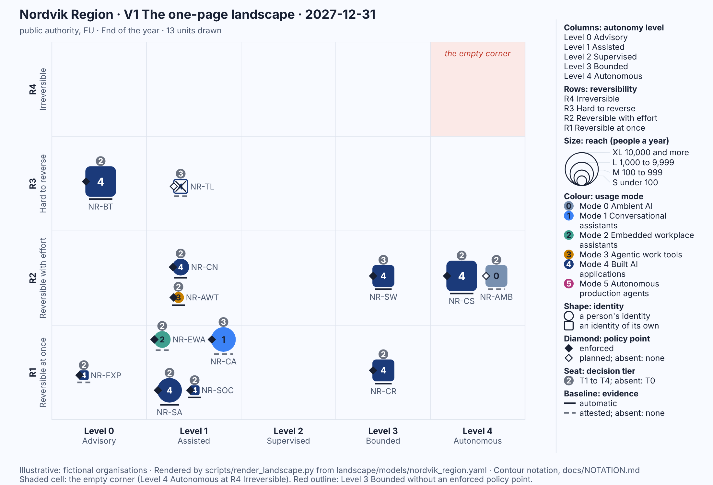
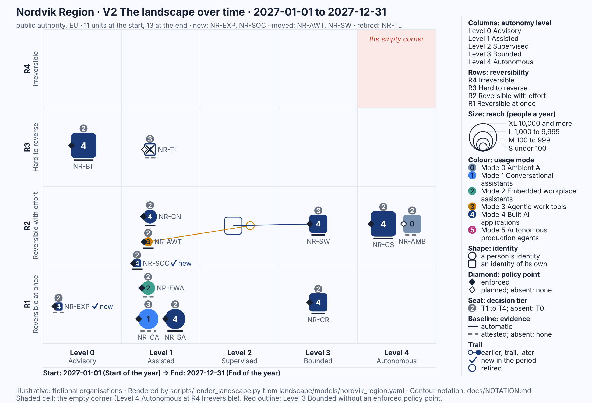
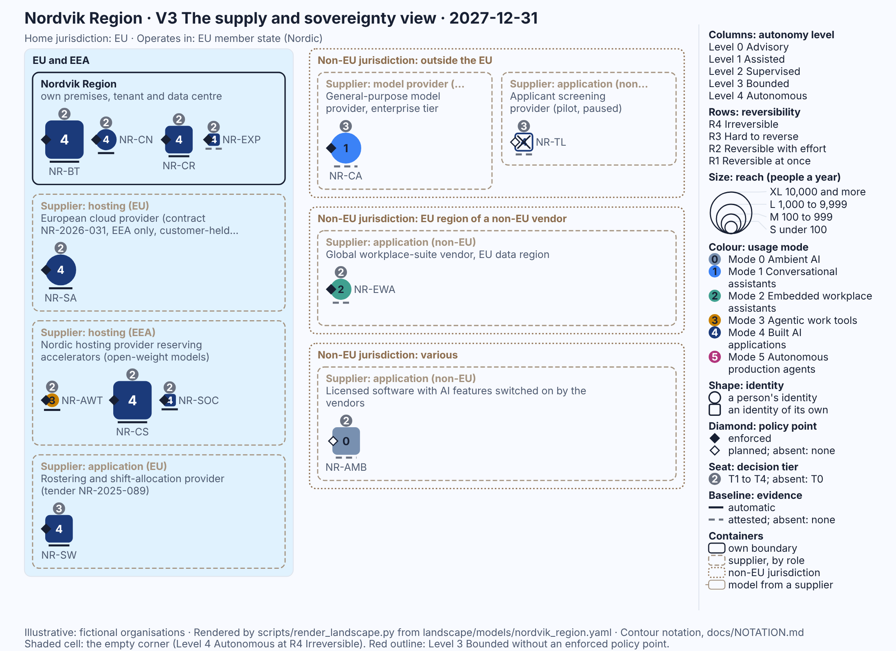
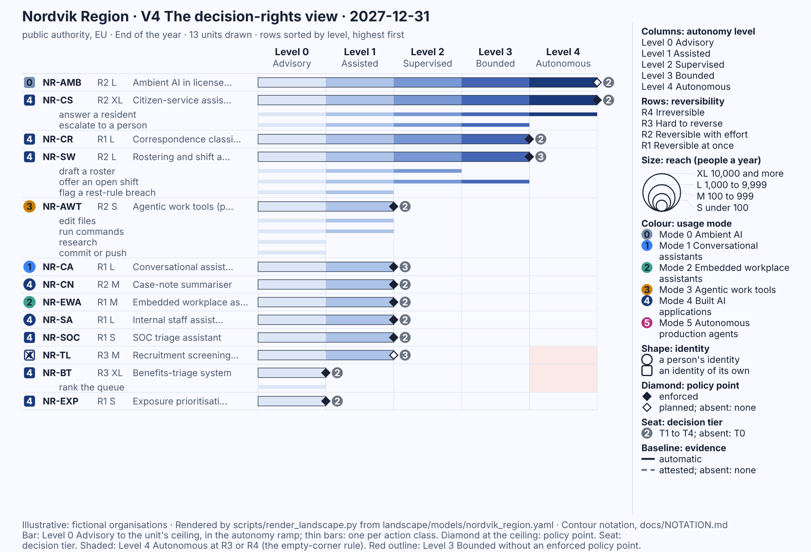
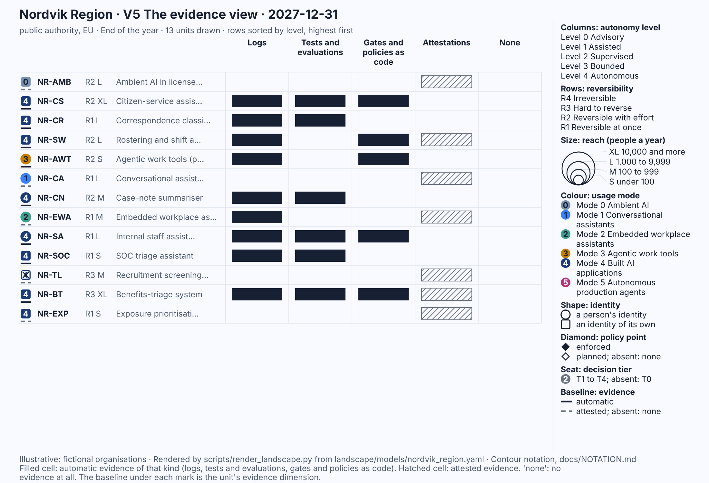
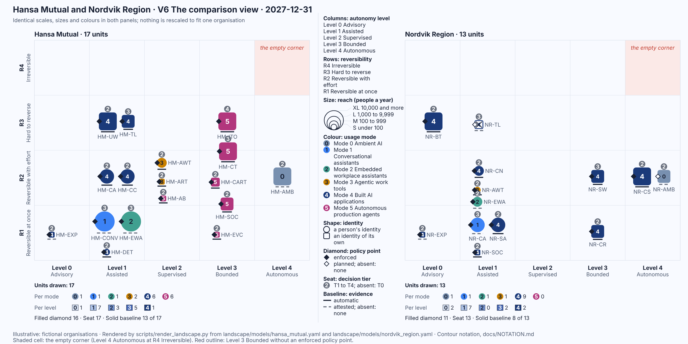

# Mermaid-contour

Adds **contour** diagrams to [Mermaid](https://mermaid.js.org): the six standard views (V1 to V6) of the
Contour notation from the book *Landscape: A Fact-Based Picture of Architecture and AI at Work*
([landscape.geon.se](https://landscape.geon.se)), as an external Mermaid diagram type.

Contour draws every use of AI in an organisation as one mark with seven dimensions: autonomy level (columns), reversibility
(rows), reach (size), usage mode (colour), identity (shape), control (a policy-point diamond and a decision seat) and evidence
(a baseline). The views are written as text and drawn by Mermaid:

| | |
|---|---|
|  | **V1 The one-page landscape** (`view landscape`): every unit as a mark on the autonomy by reversibility grid. |
|  | **V2 The landscape over time** (`view year`): two panels, the start and the end state, with trails. |
|  | **V3 The supply and sovereignty view** (`view supply`): the marks in containers by supplier role and jurisdiction. |
|  | **V4 The decision-rights view** (`view decisions`): one row per unit, a bar to its level ceiling, the diamond and the seat. |
|  | **V5 The evidence view** (`view evidence`): which kinds of evidence each unit has, automatic or attested. |
|  | **V6 The comparison view** (`view compare`): two organisations at identical scales. |

The organisations in the examples, Nordvik Region and Hansa Mutual, are fictional.

## Use

```bash
npm install mermaid-contour mermaid     # or clone this repository and run npm install
```

In a page (see `examples/index.html`; serve the repository root, for example with `python3 -m http.server`):

```html
<pre class="mermaid">
contour
  title Two units
  unit A-1 "Staff assistant" level=1 rev=R1 reach=L mode=1 policy=enforced tier=T2 evidence=attested
  unit A-2 "Code agent" level=3 rev=R2 reach=M mode=5 identity=own policy=enforced tier=T3 evidence=automatic
</pre>
<script type="module">
  import mermaid from 'mermaid';
  import { registerContour } from 'mermaid-contour';
  await registerContour(mermaid);               // before the first render
  mermaid.initialize({ startOnLoad: false });
  await mermaid.run({ querySelector: '.mermaid' });
</script>
```

Loaded as a plain `<script type="module" src="src/mermaid-contour.mjs">` after Mermaid's own script, the module registers itself with `window.mermaid`.
Note that `mermaid.run(options)` replaces its default `querySelector`, so pass `.mermaid` when you pass other options.

To render a file to SVG or PNG (Mermaid's `mmdc` cannot load external diagram types):

```bash
npx contour-render examples/view_nordvik_landscape_2027-12-31.mmd out.png     # needs Chrome or Chromium
```

Set `PUPPETEER_EXECUTABLE_PATH` if Puppeteer has no browser. The views use the Inter typeface; install it to match the pictures above.

## Syntax

```
contour
  view landscape|year|supply|decisions|evidence|compare   (default: one panel V1, two panels V6)
  title <text>    subtitle <text>    footer <text>        (footer repeats)
  panel "Organisation"                                    (V2: the start state, then the end state; V6: two organisations)
    unit ID "Name" level=0..4 rev=R1..R4 reach=S|M|L|XL mode=0..5
         [identity=person|own] [policy=enforced|planned|none] [tier=T0..T4] [evidence=automatic|attested|none]
         [status=active|planned|pilot|paused|retired] [kinds=logs,tests,gates,attestations]
         [hosting=own-premises|eu-supplier|eea-supplier|non-eu-supplier|unknown] [operated_by=self|supplier] [suppliers=id,id]
      action "rank the queue" 0                           (V4: one line per action class of the unit above)
  supplier ID "Label" "Location" role=model|hosting|application|operations jurisdiction=EU|EEA|non-EU   (V3)
```

- `level` is the autonomy level, 0 Advisory to 4 Autonomous. `rev` is the reversibility tier, R1 Reversible at once to R4 Irreversible.
  `reach` is the number of people touched in a year: S under 100, M 100 to 999, L 1,000 to 9,999, XL 10,000 and more.
  `mode` is the usage mode, 0 Ambient AI to 5 Autonomous production agents.
- An attribute that is left out is an absence and is drawn as one (`policy=none`, `tier=T0`, `evidence=none`, `hosting=unknown`), never a guess.
- Names are in double quotes; `\"` and `\\` escape a quote and a backslash. A trailing `%% comment` must follow whitespace and is never read inside quotes.
  `title`, `subtitle` and `footer` take bare text, or a quoted string when the text holds `%%`.
- Unit ids are unique within a panel, so the two organisations of V6 may reuse an id, and V2 repeats the units of the start state in the end state.
- The parser rejects values outside the scales with the line number, for example `Contour, line 2: A: level=9 must be 0 to 4`.
- The header may also be written `contour-beta`.

## How faithful it is

The geometry is a port of the Python renderer of the book (`scripts/render_landscape.py` in the Landscape repository): marks, packing of
several marks in one cell, grid, legend, summary strips, containers, hatching and text placement, in inches (1 inch = 100 SVG units).
Against that renderer, on the examples of this repository:

- every mark sits where the Python renderer puts it, to 0.001 inch (`npm run test:browser`, golden positions in `test/golden-positions.json`);
- the text wrapping equals Python 3.12's `textwrap` on 92 strings produced by Python itself (`npm test`);
- on all 20 figures of the book, the images have the same size and 0.02 to 0.7 per cent of 16 px blocks differ visibly from the book's PNGs. What differs is
  text: matplotlib and Chromium snap glyphs to whole pixels differently, so a line can sit one to three pixels off.

Tested with Mermaid 10.7.0, 11.3.0 and 11.12.0. Colours are the series palette of the book and are fixed: they do not follow Mermaid themes.
Each diagram is one view; a page may hold many diagrams. No text from a diagram is ever inserted as HTML: it is written with `textContent`.

## Tests

```bash
npm test                 # parser, quoting, text wrapping: pure functions, no browser
npm run test:browser     # renders the examples in Chromium and compares every mark with the Python renderer
```

## Relation to the book repository

The book's repository keeps its own copy of `src/mermaid-contour.mjs` (`docs/javascripts/mermaid-contour.mjs`) and the Python that writes the
diagram text from its landscape models (`scripts/contour_text.py`). The figures of the book are still drawn by its Python renderer;
this package is the interactive, web form of the same views.

## Releasing

GitHub Actions publishes to npm (`.github/workflows/publish.yml`) when a version tag is pushed, using npm's
[trusted publishing](https://docs.npmjs.com/trusted-publishers): no token is stored anywhere. The workflow checks that the tag equals the
version in `package.json`, runs `npm test`, and publishes; provenance is recorded automatically.

```bash
npm version patch          # or minor, major: edits package.json, commits, and creates the tag vX.Y.Z
git push --follow-tags
```

One-time setup, by the owner of the npm package. npm configures a trusted publisher on an existing package, so the first
version is published separately, either of these two ways:

**On a computer:** `npm login`, then `npm publish` from a clone (npm asks for your two-factor code). No token is created.

**Without a computer** (only web pages): `.github/workflows/publish-first.yml` stages the first version with a short-lived token, and you approve it on npmjs.com.

1. On npmjs.com, *Access Tokens, Generate New Token, Granular Access Token*: any name, expiration **one day**, permission
   *Read and write (stage only)* (this token cannot publish directly; that is the safer choice), packages *All packages* (the package
   does not exist yet). Copy the token.
2. On GitHub, in this repository, *Settings, Secrets and variables, Actions, New repository secret*: name `NPM_TOKEN`, value the token.
3. *Actions, publish-first, Run workflow*. When it is green, the version is staged. npm also publishes a placeholder version `0.0.0-stage` of a new package.
4. On npmjs.com open *Staged Packages* and approve the version with your two-factor code. Now `mermaid-contour` 0.1.0 is on npm.
5. At once: delete the secret `NPM_TOKEN` on GitHub, and revoke the token on npmjs.com (it expires after a day anyway).

Then, on either route:

6. On npmjs.com open the package, *Settings, Trusted publishing*, choose GitHub Actions and enter the user `gunnarnordqvist`, the
   repository `Mermaid-contour` and the workflow filename `publish.yml` (all case-sensitive).
7. Publish the next version by tag within two days (npm requires a new trusted publisher to complete its first publish in that time).
   The version in `package.json` must be higher than the one on npm and equal to the tag without the `v`. Without a computer: on GitHub
   open *Releases, Draft a new release*, in *Choose a tag* type `v0.1.1` and choose *Create new tag on publish*, target `main`, and
   publish the release. The tag starts `publish.yml`.
8. Delete `.github/workflows/publish-first.yml`, and under *Settings, Publishing access* on npmjs.com choose
   "Require two-factor authentication and disallow tokens".

## Licence

Apache-2.0, see `LICENSE`.
